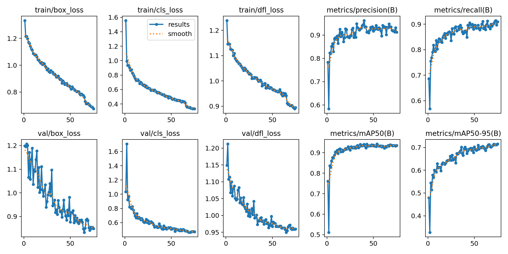
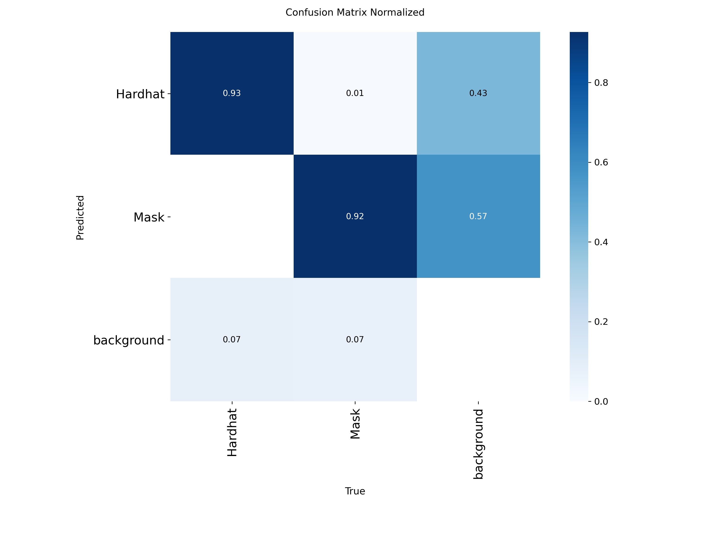
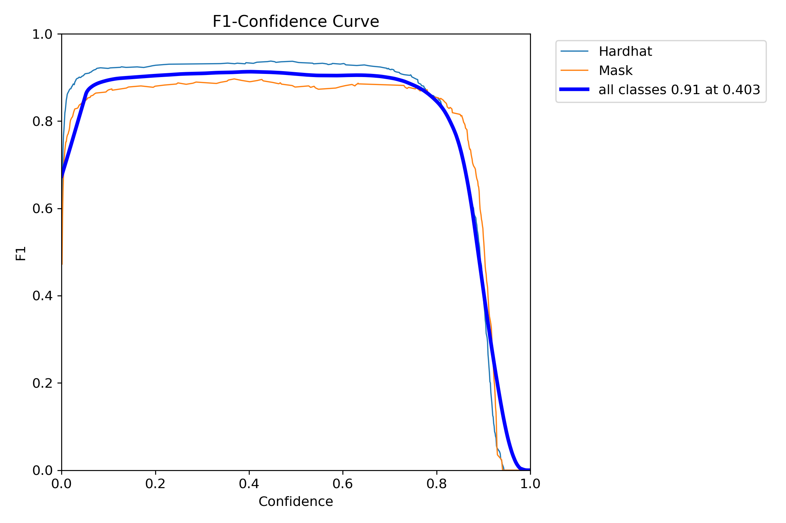
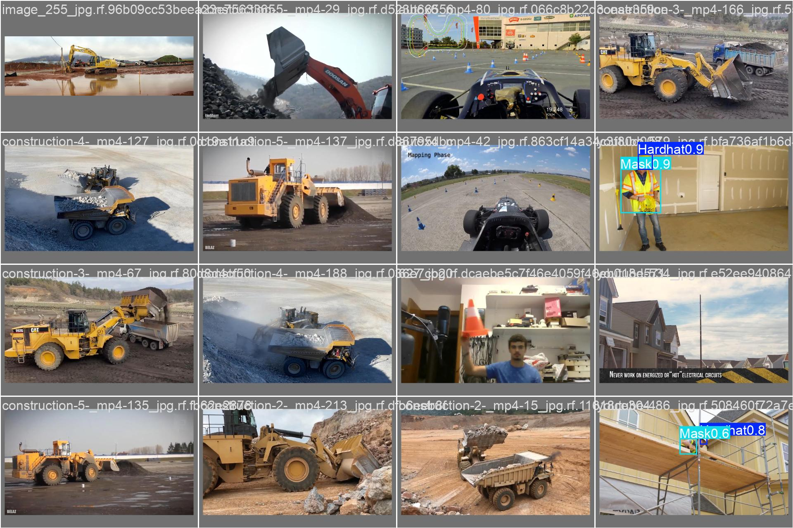

<div align="center">

# 🦺 SafeK3 (DeteksiAPD)
### Intelligent Real-Time PPE Compliance Monitoring System with IoT & Cloud Integration

[](https://www.python.org/)
[](https://github.com/ultralytics/ultralytics)
[](https://opencv.org/)
[](https://espressif.com/)
[](https://firebase.google.com/)
[](LICENSE)

<br/>

**SafeK3** adalah sistem pemantauan kepatuhan Alat Pelindung Diri (APD: Helm Safety & Rompi Keselamatan) secara otomatis dan *real-time* berbasis **Computer Vision (YOLOv8)**, perangkat keras **IoT (ESP32 Alarm Buzzer)**, serta **Cloud Monitoring Dashboard (Firebase)** untuk menciptakan lingkungan kerja yang aman dan terstandarisasi di era industri manufaktur & konstruksi.

</div>

---

## 📌 Daftar Isi
- [Latar Belakang](#-latar-belakang)
- [Fitur Utama](#-fitur-utama)
- [Arsitektur Sistem](#-arsitektur-sistem)
- [Performa Model (YOLOv8)](#-performa-model-yolov8)
- [Struktur Repositori](#-struktur-repositori)
- [Skema & Pinout Hardware](#-skema--pinout-hardware)
- [Panduan Instalasi & Penggunaan](#-panduan-instalasi--penggunaan)
- [Tampilan Dashboard Web](#-tampilan-dashboard-web)
- [Tim Pengembang](#-tim-pengembang)
- [Lisensi](#-lisensi)

---

## 💡 Latar Belakang

Kecelakaan kerja di area industri manufaktur dan konstruksi masih menjadi permasalahan serius. Data BPJS Ketenagakerjaan mencatat ratusan ribu klaim kecelakaan kerja per tahunnya, di mana sebagian besar diakibatkan oleh ketidakpatuhan penggunaan APD standar.

Sistem pengawasan konvensional yang mengandalkan patroli manual oleh petugas K3 memiliki kelemahan:
1. **Keterbatasan Cakupan**: Tidak mampu mengawasi seluruh titik produksi secara simultan selama 24/7.
2. **Human Error & Kelelahan**: Petugas rentan melewatkan pelanggaran kecil yang berpotensi fatal.
3. **Dokumentasi Lemah**: Minim bukti visual real-time yang tersimpan otomatis untuk keperluan audit K3.

**SafeK3** hadir menjembatani kesenjangan tersebut melalui otomatisasi deteksi bertenaga AI, peringatan audio di lapangan secara instan, dan pencatatan cloud terintegrasi.

---

## 🚀 Fitur Utama

- 🔍 **Real-Time PPE Detection**: Inferensi visual cepat menggunakan YOLOv8s untuk mendeteksi penggunaan **Helm (*Hardhat*)** dan **Rompi (*Vest*)** pekerja secara simultan.
- 🚨 **Physical IoT Alarm (ESP32)**: Pemicu alarm *buzzer* nirkabel via HTTP endpoint / LoRa yang langsung berbunyi ketika pekerja memasuki zona kerja tanpa APD lengkap.
- ☁️ **Cloud Realtime Database & Storage**: Logging otomatis waktu pelanggaran, zona kamera, jenis pelanggaran, tingkat akurasi (*confidence*), serta foto bukti ke Firebase.
- 📊 **Interactive Monitoring Dashboard**: Dashboard web responsif dengan tema gelap (*dark theme*) untuk pemantauan statistik harian, grafik pelanggaran, dan riwayat foto bukti audit K3.
- 🛡️ **Offline Resilient**: Tetap beroperasi optimal secara lokal (menyimpan log ke file CSV & folder screenshot lokal) meskipun koneksi internet atau modul ESP32 sedang offline.

---

## 🏗️ Arsitektur Sistem

```mermaid
flowchart TD
    A[📹 Video Feed / CCTV / Webcam] --> B[🧠 SafeK3 Computer Vision Engine\n(YOLOv8s Inferences)]
    B --> C{Pengecekan APD:\nHelm & Vest Terpasang?}
    
    C -- "Lengkap (Aman)" --> D[✅ Status Layar: AMAN\nBuzzer OFF]
    
    C -- "Tidak Lengkap (Pelanggaran)" --> E[⚠️ Status Layar: PERINGATAN]
    E --> F[💾 Simpan Bukti Lokal\n(CSV Log & JPEG Screenshot)]
    E --> G[📡 Sinyal HTTP ke ESP32\n(Buzzer Alarm Bunyi)]
    E --> H[☁️ Upload ke Firebase\n(Storage Foto & RTDB Log)]
    
    H --> I[💻 Web K3 Monitoring Dashboard\n(Statistik & Audit Log)]
    G --> J[🔊 Alarm Buzzer di Area Kerja]
```

---

## 📈 Performa Model (YOLOv8)

Model dilatih menggunakan arsitektur **YOLOv8 Small (`yolov8s.pt`)** selama **75 epoch** dengan optimizer **AdamW** pada dataset beranotasi *Safety Helmet and Vest*.

| Metrik Evaluasi | Nilai Capaian | Keterangan |
| :--- | :---: | :--- |
| **mAP@50** | **93.5% (0.935)** | Deteksi bounding box sangat presisi |
| **Precision (P)** | **91.2% (0.912)** | Tingkat false-positive sangat rendah |
| **Recall (R)** | **91.0% (0.910)** | Tingkat false-negative sangat rendah |
| **mAP@50-95** | **71.5% (0.715)** | Performa robust di berbagai threshold IoU |

<div align="center">
  
  <p><em>Grafik Progres Training: Loss & Metrik Evaluasi (75 Epochs)</em></p>
</div>

<div align="center">
  
  
  <p><em>Confusion Matrix Ternormalisasi dan Kurva F1-Score</em></p>
</div>

<div align="center">
  
  <p><em>Sampel Hasil Prediksi Deteksi APD pada Data Uji Validasi</em></p>
</div>

---

## 📁 Struktur Repositori

```text
DeteksiAPD/
├── assets/
│   ├── demo/                      # Foto pengujian & demo deteksi
│   └── metrics/                   # Kurva evaluasi, confusion matrix & hasil training
├── config/
│   └── serviceAccountKey.json.example  # Template kredensial Firebase Service Account
├── docs/
│   └── SafeK3_Proposal.docx       # Dokumen proposal perancangan sistem SafeK3
├── firmware/
│   ├── esp32_buzzer/
│   │   └── esp32_buzzer.ino       # Firmware Arduino ESP32 (HTTP WebServer + Active Buzzer)
│   └── lora_node/
│       └── safek3_lora.ino        # Firmware komunikasi LoRa alternatif (SX1278)
├── models/
│   ├── best.pt                    # Weights model YOLOv8 hasil training (mAP 93.5%)
│   ├── args.yaml                  # Hyperparameter konfigurasi training
│   └── results.csv                # Rekap metrik per epoch
├── notebooks/
│   └── SafeK3_YOLOv8_Training.ipynb  # Notebook alur training model di Kaggle/Colab
├── src/
│   ├── safek3_webcam.py           # Engine utama deteksi webcam + Firebase + ESP32
│   ├── safek3_test_foto.py        # Pengujian deteksi pada file foto statis
│   └── server_foto.py             # Server Flask lokal + tunneling Ngrok untuk dashboard
├── web/
│   ├── dashboard_k3.html          # Dashboard monitoring real-time K3
│   ├── admin.html                 # Halaman kelola admin
│   ├── login.html                 # Autentikasi Firebase Login
│   ├── register.html              # Pendaftaran akun operator
│   └── netlify.toml               # Konfigurasi deployment hosting Netlify
├── .gitignore
├── LICENSE
├── README.md
└── requirements.txt
```

---

## 🔌 Skema & Pinout Hardware

### ESP32 WiFi Buzzer Alarm Node
ESP32 bertindak sebagai aktuator alarm yang menerima instruksi via Wi-Fi dari komputer inferensi.

| Komponen Hardware | Pin ESP32 | Keterangan |
| :--- | :--- | :--- |
| **Buzzer (+)** | `GPIO 4` | Pin sinyal trigger buzzer |
| **Buzzer (-)** | `GND` | Ground |
| **LED Indikator** | `GPIO 2` | Onboard LED (indikator status Wi-Fi & alarm) |
| **Power Supply** | `V5 / Micro-USB` | Sumber daya 5V |

---

## 🛠️ Panduan Instalasi & Penggunaan

### 1. Kloning Repositori & Persiapan Environment
Pastikan Python 3.9+ telah terinstall di komputer Anda.

```bash
# Clone repositori
git clone https://github.com/raihanbaskara/DeteksiAPD.git
cd DeteksiAPD

# Buat virtual environment (disarankan)
python -m venv venv
venv\Scripts\activate      # Windows
# source venv/bin/activate # Linux / macOS

# Install dependensi
pip install -r requirements.txt
```

### 2. Konfigurasi Firebase (Opsional, untuk Cloud Sync)
1. Buat project baru di [Firebase Console](https://console.firebase.google.com/).
2. Aktifkan **Firebase Realtime Database** dan **Firebase Storage**.
3. Unduh berkas **Service Account Private Key** (`.json`) dari *Project Settings → Service Accounts*.
4. Simpan berkas tersebut ke folder `config/serviceAccountKey.json` (lihat format contoh di `config/serviceAccountKey.json.example`).
5. Sesuaikan URL `FIREBASE_DATABASE_URL` dan `FIREBASE_STORAGE_BUCKET` di file [`src/safek3_webcam.py`](src/safek3_webcam.py).

> 💡 *Catatan: Jika berkas service account tidak dipasang, sistem akan otomatis beralih ke mode **Lokal saja** tanpa menghentikan deteksi kamera.*

### 3. Flash Firmware ESP32
1. Buka berkas [`firmware/esp32_buzzer/esp32_buzzer.ino`](firmware/esp32_buzzer/esp32_buzzer.ino) di Arduino IDE.
2. Masukkan nama WiFi (`ssid`) dan kata sandi (`password`) jaringan lokal Anda.
3. Hubungkan ESP32 via kabel USB, pilih board *ESP32 Dev Module*, lalu klik **Upload**.
4. Buka *Serial Monitor* (baudrate 115200) untuk mengetahui alamat IP yang didapat (contoh: `192.168.1.50`).

### 4. Menjalankan Deteksi Real-Time

```bash
# Menjalankan deteksi menggunakan webcam default
python src/safek3_webcam.py

# Menjalankan deteksi dengan ESP32 Buzzer terhubung
python src/safek3_webcam.py --camera 0 --esp32-ip 192.168.1.50

# Menjalankan deteksi tanpa modul ESP32
python src/safek3_webcam.py --no-esp32

# Menguji deteksi pada file foto
python src/safek3_test_foto.py
```

### 5. Menjalankan Web Dashboard
- Buka langsung berkas [`web/dashboard_k3.html`](web/dashboard_k3.html) di browser modern mana saja, atau host secara langsung di [Netlify](https://www.netlify.com/) / GitHub Pages.
- Jalankan server lokal penyaji foto bukti jika diperlukan:
  ```bash
  python src/server_foto.py
  ```

---

## 🖥️ Tampilan Dashboard Web

Dashboard web SafeK3 menyediakan antarmuka analitik yang komprehensif bagi petugas keselamatan kerja:
- **Metrik Utama**: Total insiden hari ini, status kepatuhan helm & rompi, serta persentase kepatuhan area kerja.
- **Grafik Tren**: Visualisasi tren insiden per jam dan per hari menggunakan Chart.js.
- **Tabel Pelanggaran Live**: Daftar pelanggaran terperinci mencakup zona kerja, waktu kejadian, foto bukti resolusi tinggi, dan status tindak lanjut.

---

## 👥 Tim Pengembang

Projek ini dikembangkan sebagai bagian dari inisiatif penelitian dan penerapan teknologi keselamatan kerja berbasis AI & IoT pada **Program Studi S1 Pendidikan Teknik Elektro, Fakultas Teknik, Universitas Negeri Malang (UM)**:

- **Raihan Nauval Aziz** (Lead Developer / Hardware & IoT Integration)
- **Moh. Ilham Krisna Aprian** (Computer Vision & Model Training)
- **Tuhu Ayunda Mustika Sakti** (Dataset Preparation & System Evaluation)

---

## 📄 Lisensi

Projek ini didistribusikan di bawah lisensi terbuka [MIT License](LICENSE). Bebas digunakan, dipelajari, dan dikembangkan untuk keperluan akademik maupun industri.
